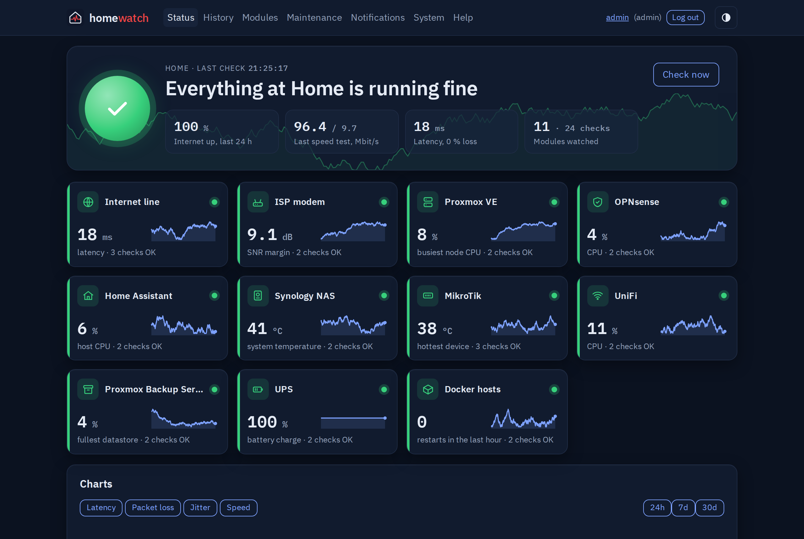
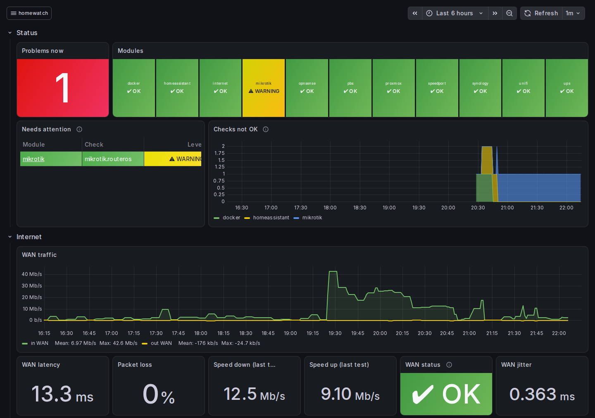
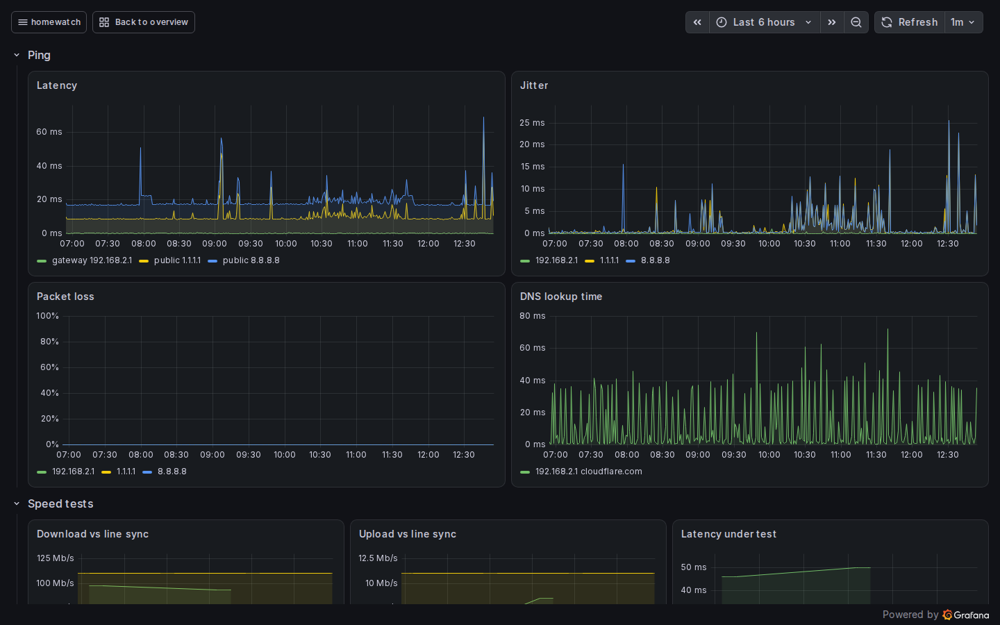
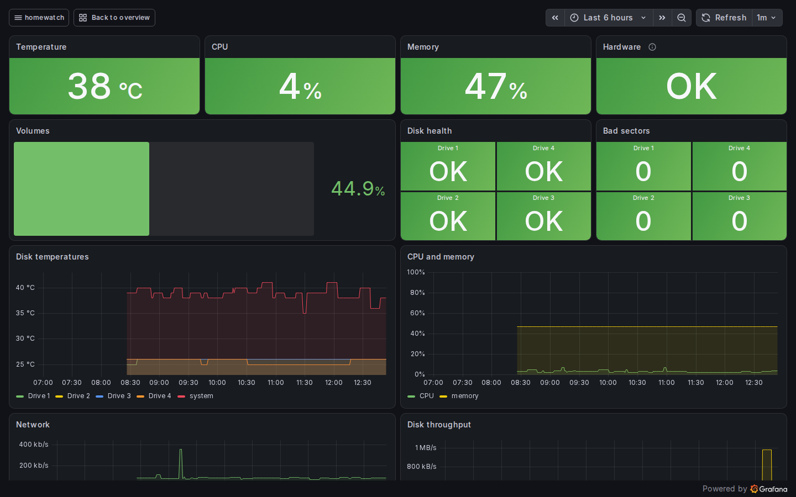
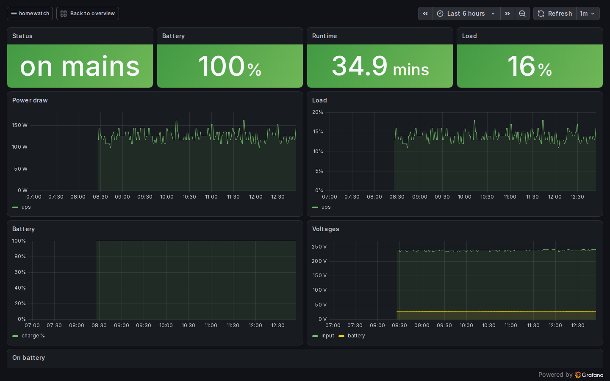

<h1>
  <picture>
    <source media="(prefers-color-scheme: dark)" srcset="docs/brand/red-homewatch-logo-dark.svg">
    
  </picture>
</h1>

A small, self-hosted monitor for your home network, configured from a plain web page.
homeWatch watches **your internet line**, **your provider's DSL modem**, **your Proxmox VE host**,
**your OPNsense firewall**, **Home Assistant**, **your Synology NAS**, **your MikroTik switches**, **UniFi**, **Proxmox Backup Server**, **your UPS** and **your Docker hosts**. It tells you *what* broke ("router unreachable", "line down", "DNS failing", "DSL link
down", "guest stopped", "backup failed") and sends alerts to Telegram, ntfy, email or a webhook.
Optionally it adds **Grafana dashboards**, an Overview and one per module, behind your homeWatch login,
with a year of history from every device, port and guest, and from the Home Assistant entities you choose.

- Runs as a Docker Compose stack on any Linux host (amd64 or arm64)
- LAN / Tailscale only: it never needs a port open to the internet
- MIT licensed



<p>
  
  
  
  
</p>

## Contents

- [Install](#install): Docker Compose stack on any Linux host, set up from a web wizard
- [Internet line](#internet-line-module): pings public servers and your router, DNS lookups, speed tests against your contract
- [ISP modem](#isp-modem-module-optional): DSL link, sync rate, noise margin, resyncs and PPP session from your provider's modem
- [Proxmox VE](#proxmox-ve-module-optional): nodes, CPU and memory, guests, storage, disk health and backups through a read-only API token
- [OPNsense](#opnsense-module-optional): gateways, CPU, services, HAProxy servers, certificates and firmware updates
- [Home Assistant](#home-assistant-module-optional): core, updates, backups, host disk / memory / CPU, plus the entities you choose (unavailable, alarm, safety, tamper, battery, add-ons, your own rules)
- [Synology NAS](#synology-nas-module-optional): system, CPU and memory, disks, pools and volumes and DSM updates over the DSM Web API
- [MikroTik](#mikrotik-module-optional): ports up, port errors, CPU and memory, reboots and RouterBOOT over the REST API, plus optional RouterOS update checks and daily configuration copies
- [UniFi](#unifi-module-optional): devices online, CPU, Wi-Fi, restarts and firmware updates, as a view-only user
- [Proxmox Backup Server](#proxmox-backup-server-module-optional): datastores and their deduplication factor, recent backups, verify/prune/garbage-collection jobs and updates
- [UPS](#ups-module-optional): mains power, battery charge, runtime, load and UPS health from a NUT server
- [Docker hosts](#docker-hosts-module-optional): containers running, restarts, health checks and removed containers, through a read-only socket proxy
- [Alerts and notifications](#alerts-and-notifications): Telegram, ntfy, email, webhook and a healthchecks.io heartbeat
- [Grafana dashboards](#grafana-dashboards-optional): an Overview and one dashboard per module, with your homeWatch login
- [Update](#update) · [Back up](#back-up) · [Security notes](#security-notes) · [Development](#development)

## Install

You need a Linux host with Docker Engine and the Compose plugin
(2 CPU, 2 GB RAM and 10 GB disk are plenty; add 2 GB of disk for Grafana). No Docker yet? Install it from Docker's own repository,
following https://docs.docker.com/engine/install/ for your distribution (Debian:
https://docs.docker.com/engine/install/debian/), then add your user to the `docker` group
(`sudo usermod -aG docker $USER`) and log in again.

```sh
mkdir homewatch && cd homewatch
for f in docker-compose.yml Caddyfile env.example install.sh update.sh; do
  curl -fsSLO "https://github.com/nikosiaf/homewatch/releases/latest/download/$f"
done
chmod +x install.sh update.sh
less install.sh
./install.sh
```

Please read `install.sh` before running it (`less install.sh`, `q` to quit); it's short.

`install.sh` does five things:
- writes `.env` with a new master key, the host's time zone, and its gateway and DNS server as defaults
- creates a self-signed certificate in `certs/`
- offers the updater (asks first, needs sudo once): a systemd unit that installs the latest release when
  you press Update on the System page (see [Update](#update))
- asks whether to add [Grafana](#grafana-dashboards-optional) (default no; `--grafana` / `--no-grafana`
  answer without asking, and the System page can turn it on or off later)
- runs `docker compose up -d`

homeWatch listens on port **5443** (HTTPS) and **5080** (HTTP, which only redirects to HTTPS), so it
doesn't clash with a web server already on 80 or 443. Other ports: `./install.sh --https-port 8443
--http-port 8080`, or change `HW_HTTPS_PORT` and `HW_HTTP_PORT` in `.env` and run `docker compose up -d`.
`install.sh` stops if a port is already in use. With `HW_HTTPS_PORT=443` the address is just
`https://<host>`.

At the end it prints the address and the certificate's SHA-256 fingerprint. Open `https://<host>:5443` and compare that
fingerprint when the browser warns about the certificate (once). Create the admin account right
away: until it exists (after an install or a reset), whoever opens the page first creates it.
Then follow the setup wizard:
1. Admin account
2. Home name and time zone
3. Internet probes and contracted speed
4. Your equipment: tick what you have (modem, firewall, switches, Wi-Fi, servers, NAS, Home Assistant,
   UPS, Docker hosts); the wizard then opens each one's module page in turn, with its setup steps and
   Connect, and you can skip any of them
5. A notification channel
6. Heartbeat

### Manual install (without install.sh)

```sh
cp env.example .env && chmod 600 .env    # .env.example in a git checkout
openssl rand -base64 32          # put it in .env as HW_MASTER_KEY=…; also set TZ
mkdir certs && openssl req -x509 -newkey ec -pkeyopt ec_paramgen_curve:P-256 -nodes -days 3650 \
  -keyout certs/key.pem -out certs/cert.pem -subj "/CN=homewatch" -addext "subjectAltName=IP:<host ip>"
docker compose up -d             # then open https://<host>:5443 (HW_HTTPS_PORT in .env)
```

## What homeWatch does

### Internet line module

| Probe | Default | Checks |
|---|---|---|
| Public ping | 1.1.1.1 and 8.8.8.8, every 30 s | Internet reachable, packet loss, latency, jitter |
| Gateway ping | your router, every 30 s | Gateway reachable |
| DNS lookup | `cloudflare.com` via your router, every 60 s | DNS failing / slow |
| Speed test | Cloudflare (or Ookla CLI), every 6 h, off by default | Line speed against your contract |

Every probe can be switched off, and every threshold changed, in the web page.

| Check | WARNING | ERROR |
|---|---|---|
| Internet reachable | | all public targets at 100 % loss |
| Packet loss (5-min average) | ≥ 25 % | ≥ 50 % |
| Latency (5-min median) | ≥ 200 ms | |
| Jitter (10-min median) | ≥ 50 ms | ≥ 100 ms |
| Gateway reachable | | 100 % loss |
| DNS | ≥ 500 ms | lookups fail while ping works |
| Line speed | < 50 % of contract on 2 tests in a row | optional level, e.g. < 30 % |
| Speed test recent | no successful test for 7 h | |
| Speed test latency | > 40 ms on 2 tests in a row | |
| Probe data fresh | | no data for > 3 min |

### ISP modem module (optional)

Reads the DSL line from your provider's modem every 15 minutes. Read-only: nothing on the modem
is changed. Supported model:

- **Telekom Speedport Plus 2** (Sercomm VD4224BDTP / VD4224BDT), the modem-router TELEKOM
  (formerly COSMOTE) provides for VDSL and FTTH connections in Greece.

| Check | WARNING | ERROR |
|---|---|---|
| Modem readable | | can't log in or read for 2.5 read intervals |
| DSL link | | the modem has no sync |
| Sync rate (share of the contracted speed) | < 85 % | < 50 % |
| SNR margin (lower of down and up) | < 6 dB | < 3 dB |
| Resyncs in 24 h (each one is a Grafana marker) | ≥ 3 | ≥ 5 |
| PPP session on the modem | | down (off by default; for router-mode setups) |

Things to know before you add a modem:
- **Password:** the Speedport has only its admin login, so homeWatch stores that password
  (encrypted, never shown again).
- **Sessions:** each reading logs in, which ends any open browser session on the modem.
- **Rejected logins:** after a rejected login homeWatch waits 6 hours, because the modem slows
  down further attempts.
- **Certificate:** the modem's certificate is self-signed, so homeWatch trusts the one it sees at
  the first reading and logs in only to that one. If it changes, the check goes to ERROR and
  homeWatch stops logging in until you accept the new one on the module page. The first reading
  itself can't tell an impostor from the modem, so add the modem on a network you trust.

### Behind a reverse proxy

If browsers reach homeWatch through a reverse proxy (HAProxy, nginx…), put the proxy's address in
`HW_TRUSTED_PROXIES` in `.env`, for example `HW_TRUSTED_PROXIES=192.168.1.1`, and run
`docker compose up -d`. The proxy must send `X-Forwarded-For`. Without this setting every visitor
counts as the proxy's address, so one person's failed logins lock everyone out for 5 minutes.
Don't list anything that isn't a proxy: whoever is listed can claim to be any address.

### Proxmox VE module (optional)

Watches a Proxmox VE host or cluster through a **read-only API token** (role PVEAuditor; the module
page shows the three commands to create it). homeWatch tests the token before saving anything.

| Check | WARNING | ERROR |
|---|---|---|
| API reachable | | can't connect, or the token is rejected |
| Node online | | a node is offline |
| Node CPU / memory / root disk | ≥ 85 / 90 / 85 % | ≥ 95 % |
| Guests running | | a guest you chose to watch is not running |
| Storage | ≥ 85 % full | ≥ 95 % full, or a storage unavailable |
| Disk health | SSD life left < 20 % | SMART not PASSED, or life left < 10 % |
| Backups (watched guests in a backup job) | newest > 26 h old, or none yet | newest > 50 h old, or the last attempt failed |

Backup results come from Proxmox's backup task logs (a read-only token can't list backup contents);
each log is read once.

### OPNsense module (optional)

Reads an OPNsense firewall through the API key of a user that has only the status pages it needs
(the module page lists them). Missing privileges show as "not readable", not as alarms. For the
Grafana traffic graphs, also give it **Reporting: Traffic**.

| Check | WARNING | ERROR |
|---|---|---|
| Gateways | packet loss or delay | a gateway down |
| CPU (10-minute average) / memory (without ZFS cache) / root disk | ≥ 85 / 90 / 85 % | ≥ 95 % |
| Services (the ones you choose) | | not running |
| HAProxy servers | | a health-checked server down |
| Certificates in use | expires in < 20 days | < 7 days, or expired |
| Firmware (to do) | updates found at the last check, or reboot needed, for 7 days | |

### Home Assistant module (optional)

Reads Home Assistant with the long-lived token of a dedicated **non-admin** user. Setting it up has
three steps on the module's page: **connect** (address and token), review **Checks and limits** and
the optional **host sensors**, then, if you want, tick **entities** under "Additional configuration".

Home Assistant's own health is checked from the start:

| Check | WARNING | ERROR |
|---|---|---|
| Core | starting, stopping, or safe / recovery mode | |
| Updates (to do; skipped versions don't count) | updates available for 14 days | |
| Automatic backups | last success > 26 h ago | > 50 h ago, or the last attempt failed |
| Disk use of the host (%) | ≥ 80 % | ≥ 90 % |
| Memory use of the host (%) | ≥ 80 % | ≥ 90 % |
| CPU use of the host (%) | ≥ 90 % | ≥ 98 % |

**Disk, memory and CPU** come from the System Monitor integration's disk use, memory use and processor
use sensors, or from any sensors in % you name under **Host sensors** (after connecting). Without
them, the checks stay OK with a note. CPU peaks are normal, so its limits start high (90 % / 98 %).
Their values are always kept and shown on the Home Assistant dashboard in Grafana.

**Entities.** Every entity is listed by domain with its state, and **nothing is ticked at first**.
Domains with nothing worth watching or graphing (automations, scripts, scenes, buttons, events,
updates, cameras, calendars, voice and notify services…) are left out. Entities that appeared since
you last saved the list carry a **new** badge.

- **Watch**: homeWatch reads it at every check (2 minutes by default) and reports it when it has been
  unavailable for 30 minutes. Some kinds also get their own check:

  | Check (only listed once such an entity is watched) | WARNING | ERROR |
  |---|---|---|
  | Unavailable entities (30 min or longer) | ≥ 1 | ≥ 10 |
  | Alarm panels | | triggered |
  | Safety sensors (smoke, water / moisture, gas, CO, heat, safety) | | detecting |
  | Tamper sensors | | tampered |
  | Batteries (lowest watched battery, %) | < 25 % | < 10 % |
  | Add-ons (their Running sensors) | | not running |
  | Entity rules (your own) | a rule set to warning fires | a rule set to error fires |

- **Show in Grafana** (only when [Grafana](#grafana-dashboards-optional) runs): the entity is on the
  Home Assistant dashboards. Numbers are kept as they are, on/off-like states as 1/0; thermostats also
  keep the current and target temperature and whether they heat, lights their brightness.
- **Rule**: your own condition on a watched entity: `is` / `is not` compare the state as text,
  `below` / `above` as a number, then `warning` or `error`; several rules with `;` between them, the
  worst that fires counts.

  | Entity | Rule | Means |
  |---|---|---|
  | `sensor.heating_oil` | `below 200 warning; below 100 error` | WARNING under 200, ERROR under 100 |
  | `sensor.nvme_temperature` | `above 65 warning` | a disk getting hot |
  | `binary_sensor.panel_ac_trouble` | `is on error` | an alarm panel trouble |
  | `person.anna` | `is not home warning` | away |
  | `sensor.panel_link` | `is not online error` | anything but "online" |

Values are stored only for ticked entities (either column). When you untick both boxes of an entity,
homeWatch asks whether to keep or delete what it has stored so far.

**Add-ons** (Home Assistant OS / Supervised): a non-admin user can't read the Supervisor, so homeWatch
uses the add-ons' **Running** sensors. They are disabled by default: in Settings → Devices & services →
Home Assistant Supervisor, open each add-on that must always run, enable its "Running" sensor, then
tick Watch for it in homeWatch.

Upgrading from 0.35 or older: the old lists (entities to watch, unavailable ones to ignore, entities
to record, rules by pattern) are turned into ticks once, at the first reading. What was watched stays
watched, what was recorded is shown in Grafana, and a pattern rule is copied to each entity it
matched. The change is a configuration version, so it can be undone under System.

### Synology NAS module (optional)

Reads DSM through its Web API every 10 minutes by default (log in, read, log out). DSM has no read-only
administrator role, so the setup asks for a separate `homewatch` administrator with no access to
shared folders or applications.

| Check | WARNING | ERROR |
|---|---|---|
| System | ≥ 60 °C, or DSM's temperature warning | ≥ 70 °C, or a crashed system |
| CPU / memory | ≥ 85 / 90 % | ≥ 95 % |
| Disks | hottest ≥ 50 °C | ≥ 60 °C, a disk not normal, SMART failing or bad sectors |
| Pools and volumes | fullest volume ≥ 85 %, or repairing / scrubbing | ≥ 95 %, degraded or crashed |
| DSM updates (to do) | update available for 14 days | |
| Fans and power (optional, SNMPv3) | SNMP can't be read | a fan, the power supply or the system failed |

DSM's Web API doesn't report fans or the power supply; the NAS's SNMP agent does. To watch them,
enable SNMP in Control Panel → Terminal & SNMP, tick SNMPv3 and create a user (authentication SHA
and privacy AES are the safe choices; MD5, SHA256, DES and no privacy work too). On the module's
page, tick SNMPv3 and enter the same user, protocols and passwords, with "SNMP privacy" ticked or
not as in DSM. homeWatch reads UDP port 161 of the NAS at each DSM read. Untick SNMPv3 to skip it.

### MikroTik module (optional)

Reads one or more RouterOS 7 devices over the REST API with a user in the `read` group (the same
user on every device). The device's `www` service must allow the homeWatch host.

| Check | WARNING | ERROR |
|---|---|---|
| Every device read | | one of several devices can't be read |
| CPU / memory / temperature | ≥ 85 % / 90 % / 60 °C | ≥ 95 % / 95 % / 70 °C |
| Ports up (the ones you choose) | | a chosen port down |
| Port errors in the last hour | ≥ 10 | ≥ 1000 |
| Reboots in 24 h (each one is a Grafana marker) | ≥ 2 | |
| RouterBOOT (to do) | older than the installed RouterOS for 14 days | |
| RouterOS updates (option, to do) | a newer RouterOS for the device's channel, waiting 7 days | |
| Configuration copies (option) | no good copy for 2 days | |
| Configuration changed (option, off by default) | for 24 h after a device's configuration changed | |

CPU, memory and temperature list every device, worst first (`core 46 % | lan 44 %`).

Two options on the module page, both off until you tick them:

- **Check daily for RouterOS updates:** once a day homeWatch reads the newest RouterOS of each
  device's update channel (stable, long-term…) from `upgrade.mikrotik.com`. It needs internet access
  from the homeWatch host. Nothing is downloaded to, or changed on, the devices; update them yourself
  (System → Packages → Check For Updates), then upgrade RouterBOOT (System → RouterBOARD → Upgrade)
  and reboot.
- **Keep a daily copy of the configuration:** once a day homeWatch saves each device's `/export`,
  read with the same read-only user, and keeps a new copy only when something changed (60 per
  device). The module page lists the copies, shows **What changed** between two of them and offers
  each as a `.rsc` download. The `read` group can't see passwords, keys and secrets, so the copies
  leave them out. To restore: reset the device without its default configuration, `/import` the file,
  then enter the passwords, Wi-Fi keys and secrets again. The copies live in homeWatch's data volume,
  so they are part of its [backups](#back-up).

### UniFi module (optional)

Reads the devices of a UniFi Network application (UniFi OS Server or a UniFi console) as a local
**view-only** user: log in, read, log out.

| Check | WARNING | ERROR |
|---|---|---|
| Devices online (the ones you choose) | upgrading or provisioning | disconnected, heartbeat missed |
| CPU (busiest watched device) | ≥ 90 % | |
| Wi-Fi | WLAN subsystem not OK | |
| Restarts in 24 h (each one is a Grafana marker) | ≥ 2 | |
| Firmware (to do) | update available for 14 days | |

### Proxmox Backup Server module (optional)

Reads PBS every 15 minutes by default through an API token with the read-only **Audit** role (the module page
shows the commands to create it).

| Check | WARNING | ERROR |
|---|---|---|
| Datastores | fullest ≥ 85 % | ≥ 95 %, or a datastore error (e.g. not mounted) |
| Backups (the groups you choose) | newest snapshot > 26 h old | > 50 h old, or no snapshots |
| Verify, prune, garbage collection, sync | latest run had warnings | latest run failed (last 8 days) |
| Updates (to do) | package updates available for 14 days | |

The Datastores table and the Grafana dashboard also show each datastore's **deduplication factor**,
as the PBS web interface does: the size of all backups over the space their chunks take on disk,
from the last garbage collection.

### UPS module (optional)

Reads a UPS from a **NUT server** (Network UPS Tools), for example on your Proxmox host or NAS.
Reading needs no login; the NUT server must listen on the network.

| Check | WARNING | ERROR |
|---|---|---|
| NUT server reachable | | unreachable, or the UPS data is stale |
| Mains power | | on battery, or a forced shutdown under way |
| Battery charge | < 50 % | < 30 % |
| Runtime | < 10 min | < 5 min |
| Load | ≥ 80 % | ≥ 95 % |
| UPS health | replace battery | overload |

### Docker hosts module (optional)

Reads one or more Docker hosts through a **read-only proxy** in front of the Docker socket
([linuxserver/socket-proxy](https://docs.linuxserver.io/images/docker-socket-proxy/) with only
`CONTAINERS=1` and `INFO=1`; `POST=0`, so nothing can be started, stopped or changed).
Reading containers includes their environment variables, which often hold passwords: **only homeWatch
may reach the proxy**. On homeWatch's own host the proxy joins homeWatch's network and publishes no
port; on other hosts it runs with `network_mode: host` and the host firewall (ufw / nftables) allows
port 2375 from homeWatch only. The setup steps on the module page have the compose file and rules.

Containers with a restart policy (`always`, `unless-stopped`, `on-failure`) are watched; untick any
under "Containers to watch" (grouped per host and compose project).

| Check | WARNING | ERROR |
|---|---|---|
| Hosts reachable / every host read | | a host can't be read |
| Containers running | | a watched container is not running |
| Restarts (watched containers, last hour) | ≥ 1 | ≥ 3 |
| Health checks | a watched container is unhealthy | |
| Containers removed (save the page to accept) | a watched container is gone | |

### How often each module is read

Each module's page has a **Read every (minutes)** box next to its password or token. The defaults keep
alerts quick where they matter and spare devices where they don't. A problem is alerted after two
readings agree, so expect an alert one to two read intervals after it starts.

| Module | Default | Why |
|---|---|---|
| Internet line | continuous probes, checked every 2 min | the line itself |
| UPS, Home Assistant | 2 min | power events, alarm and safety sensors |
| MikroTik, UniFi, OPNsense, Proxmox VE, Docker | 5 min | each read logs in; a stop or a down port waits a few minutes |
| Synology NAS | 10 min | each read is a DSM login |
| Proxmox Backup Server | 15 min | backups run nightly |
| ISP modem | 15 min | its own setting |

### Alerts and notifications

Notification providers: **Telegram**, **ntfy** (one topic URL), **email** (any SMTP server; port
465 = TLS, other ports STARTTLS, a password is never sent unencrypted), **webhook** and the
**healthchecks.io heartbeat**.

Alerting works like this:
- **Confirmation:** a change must hold for 2 runs (about 4 minutes) before it's sent.
- **To do instead of problems:** updates and firmware (Home Assistant, PBS, DSM, UniFi, RouterOS and
  RouterBOOT, OPNsense) are listed under To do on the Status page and in the weekly report. They become a
  WARNING only after waiting 14 days (7 for OPNsense and RouterOS); the limit is editable per check.
- **Events, not warnings:** a single DSL resync or device reboot is an event and a Grafana marker; a
  WARNING comes when it repeats (3 resyncs or 2 reboots in 24 h by default).
- **Flapping entities:** a Home Assistant entity that keeps going unavailable and coming back by itself
  (3 short spells in 7 days) is named but not counted, unless you untick that in the module's settings.
- **Useful or noise:** mark problems on the History page; the weekly report lists the noisiest checks.
- **Reminders:** open problems are repeated every 12 h.
- **Offline queue:** messages that can't be sent while the line is down go out when it's back, with the outage times.
- **Snooze and maintenance windows:** they hold notifications without losing the history.
- **Quiet hours** per channel: warnings wait until they end, errors are always sent.
- **Weekly report:** optional; pick the day, the time and the channels. It has the week's uptime, line
  quality and speed, the longest issues, what is still to do and the checks with the most issues.
- **healthchecks.io heartbeat:** optional. homeWatch pings it after every run, and healthchecks.io
  alerts you when the pings stop (host, power or internet down).
- **History** is a timeline of every problem and its return to OK.

**Configuration versions** (System page): every saved change to modules, thresholds, timing, channels
or maintenance windows is kept as a version (last 200), showing who changed what. Each can be viewed
and restored; a restore is itself a version, so it can be undone. Passwords, tokens and users are
never part of a version.

### Webhook

The webhook channel POSTs every message as JSON to the URL you enter. The URL is stored encrypted
like a password (webhook URLs usually contain a token) and is never part of an export:

```json
{"text": "🔴 Home: ERROR\n\n…", "content": "🔴 Home: ERROR\n\n…", "title": "🔴 Home: ERROR",
 "body": "…", "level": 2, "level_name": "ERROR", "sent": 1793260000}
```

`text` makes it work as-is with Slack, Mattermost and Rocket.Chat incoming webhooks, `content` with
Discord (cut to 2000 characters). For Home Assistant, Node-RED or n8n use `level` / `level_name`,
`title` and `body`.

There are two account roles: **admin**, who can change everything, and **viewer**, who can only see
status and history.


## Grafana dashboards (optional)

Grafana shows everything homeWatch stores (every device, port, guest, disk, and the Home Assistant
entities you show in Grafana) at `https://<homewatch>/grafana/`. It has no login of its own: homeWatch signs
you in. homeWatch admins are Grafana admins, viewers can only look.

- **On or off:** `install.sh` asks; later, **System → Grafana and history**. It needs about 2 GB of
  disk and 150 MB of memory. Turning it off keeps its dashboards. By hand: `COMPOSE_PROFILES=grafana`
  in `.env` (empty to turn it off), then `docker compose up -d`.
- **Built-in dashboards** (folder *homeWatch*): an Overview and one per enabled module. homeWatch
  rebuilds them with every update, so they can't be saved; switching a module off removes its dashboard.
- **Your own dashboards:** open a built-in one, **Save as**, and keep the copy in **My dashboards**.
  Updates never touch that folder, and homeWatch saves it every night next to the configuration
  exports (System → Grafana and history, last 14).
- **From homeWatch:** an open Status tile has a small Grafana icon next to its line, and the menu has
  **Grafana ↗**; both open in a new tab and show only while Grafana runs.
- **Resolution** follows each module's [read interval](#how-often-each-module-is-read).
- **Data source:** *homewatch*, the VictoriaMetrics that homeWatch already runs (PromQL / MetricsQL).
  Metric names start with `hw_`; Grafana's Explore lists them.
- **History length:** a year by default. **System → History** can keep less (6, 3 or 1 month): data
  older than that is deleted, and VictoriaMetrics drops whole months, so space can take up to a month
  to come back. Issues, speed tests and settings are not affected.

## Update

The System page says when a newer release exists (it checks GitHub once a day, or when you press
Check now). With the updater installed, press **Update to x.y.z** under Health. A page shows what
happens and the release notes; after **OK, update now** a progress page follows the update and opens
the Status page when the new release answers. After 5 minutes without an answer it says the update
failed.

The updater is a systemd unit on the host (`homewatch-update.path`) that runs `update.sh`. homeWatch
gets no Docker access for it: the button only leaves a request file in `update/ask/`. The script
compares that file's first line with a few fixed words (`grafana on`, `grafana off`, `retention 1y`,
`180d`, `90d`, `30d`, from the System page); anything else means "update". It asks GitHub for the latest
release itself, sets `HW_VERSION` in `.env`, then pulls and restarts. If the download fails, or the new release isn't healthy within 3 minutes,
it puts `.env` back and starts the previous release again. It reports to `update/status`, which the
System page shows. It doesn't update `docker-compose.yml`, `Caddyfile` or `update.sh`: when a release
changes them, its release notes say so. Then download them from the release next to `install.sh`, run
`docker compose up -d`, and with the updater `sudo ./update.sh` once (it tells homeWatch what it can do). To add the updater to an existing install, put `update.sh` from the release next to
`install.sh` and run `./install.sh` again (it keeps `.env` and the certificate). To remove it:
`sudo systemctl disable --now homewatch-update.path`.

Without the updater, set `HW_VERSION` in `.env` to the new release, then run:

```sh
docker compose pull && docker compose up -d
```

Database changes apply on start.

## Back up

Everything homeWatch knows lives in two Docker volumes:
- `homewatch_hw-data`: settings, users, history, encrypted tokens, MikroTik configuration copies (and the nightly exports)
- `homewatch_vm-data`: metrics

With Grafana, also `homewatch_grafana-data` (your own dashboards; the built-in ones are recreated).

**Settings export:** System → Export and import downloads all settings as one YAML file (modules,
thresholds, timing, channels, maintenance windows; no passwords, tokens or users). homeWatch also
writes one every night into the data volume (`exports/`, last 14 kept). Importing a file replaces
the settings; the previous ones stay under Configuration versions, so an import can be undone.

**Full backup and recovery:** keep a copy of `.env` somewhere other than this host, such as a
password manager. `HW_MASTER_KEY` decrypts every stored password and token. Without it the data still
opens, but modules show `WrongMasterKey` until you enter each credential again.

Run these in the folder that holds `docker-compose.yml`. The backup is encrypted with a passphrase of
your choice, because it holds users, history and the encrypted secrets. It needs `gpg`
(`sudo apt install gnupg` on Debian):

```
docker compose stop controller
docker run --rm -v homewatch_hw-data:/data:ro alpine tar czf - -C /data . | gpg -c -o homewatch-data.tar.gz.gpg
docker compose start controller
```

To restore, on the same or a new host, with the original `.env` in place:

```
docker compose create
gpg -d homewatch-data.tar.gz.gpg | docker run --rm -i -v homewatch_hw-data:/data alpine tar xzf - -C /data
docker compose up -d
```

Metrics (`homewatch_vm-data`) can be copied the same way, with `victoriametrics` stopped. Without them,
charts start empty but settings and history are intact.

## Ookla speed test (optional)

The default speed test uses Cloudflare and needs nothing extra. To use Ookla instead:
1. Go to **Modules → Internet line** and pick **Ookla Speedtest CLI** as the engine.
2. Accept Ookla's EULA and privacy policy.
3. Press **Save and install Ookla CLI**.

homeWatch then downloads the official CLI from speedtest.net for your processor (x86_64, arm64 or
armhf) into its data volume. It isn't bundled with homeWatch, because Ookla's license doesn't
allow redistribution. **System → Health** shows the installed version.

## Security notes

- **Exposure:** don't forward homeWatch to the internet. Use it on your LAN or over Tailscale.
- **Outbound:** besides the devices you add, homeWatch reaches only the internet servers you set it to
  use: the public servers the Internet module pings and asks for DNS lookups, the speed-test service,
  your notification channels, GitHub for the daily release check (which you can turn off) and, if you
  tick it, `upgrade.mikrotik.com` once a day for the newest RouterOS version.
- **Network:** only Caddy publishes ports: HTTPS on 5443 and HTTP on 5080, which only redirects to HTTPS
  (`HW_HTTPS_PORT` / `HW_HTTP_PORT` in `.env`). VictoriaMetrics, Telegraf, Grafana and
  the controller stay on internal Docker networks.
- **Grafana:** reached only through Caddy, which asks homeWatch who you are first. Grafana trusts the
  user name homeWatch hands it only from the small private network it shares with Caddy, homeWatch and
  VictoriaMetrics; Caddy removes those headers from what browsers send.
- **Secrets:** tokens and URLs are encrypted at rest (AES-GCM, key from `.env`) and never shown
  again after saving.
- **Logins:** passwords are hashed with Argon2. Sessions use HttpOnly, Secure, SameSite=Strict
  cookies, and the database holds only hashes of session tokens. Every form is CSRF-protected, and
  logins lock for 5 minutes after 5 failures from one address or 20 on one account.
- **Device certificates:** with "Check the HTTPS certificate" unticked, homeWatch pins the certificate
  it sees first and logs in only to that one. That first connection can't tell an impostor from the
  device, so compare the fingerprint on the module's page with the device. System lists how each
  device connection is protected.
- **Containers:** image versions are pinned, and the controller runs as a non-root user on a
  read-only filesystem.

## How it fits together

```
browser ──HTTPS──▶ caddy ──▶ controller (FastAPI: UI, checks every 120 s, notifier, speed test)
                                 │  ▲                        │
                     SQLite ◀────┘  │ reads              Telegram / ntfy / healthchecks.io
                                    │
telegraf (ping, DNS) ──writes──▶ victoriametrics ◀──reads── grafana (optional, /grafana/ via caddy)
```

## Development

```sh
cd controller && pip install -r requirements-dev.txt && python -m pytest -q
cd deploy && ./install.sh --dev      # builds the controller from source
```

## License

MIT, see [LICENSE](LICENSE). The IBM Plex fonts in `controller/homewatch/static/fonts` are under the SIL Open
Font License (`OFL.txt` there).
